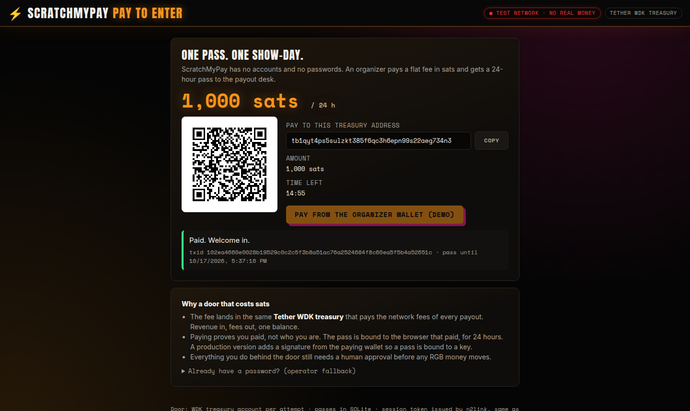
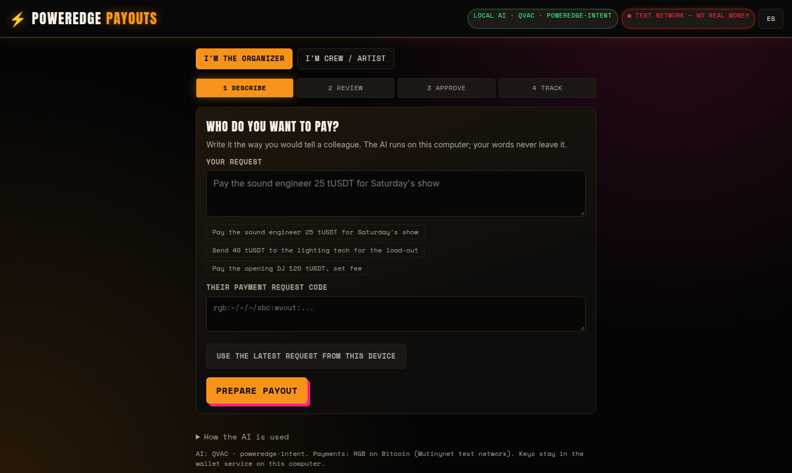
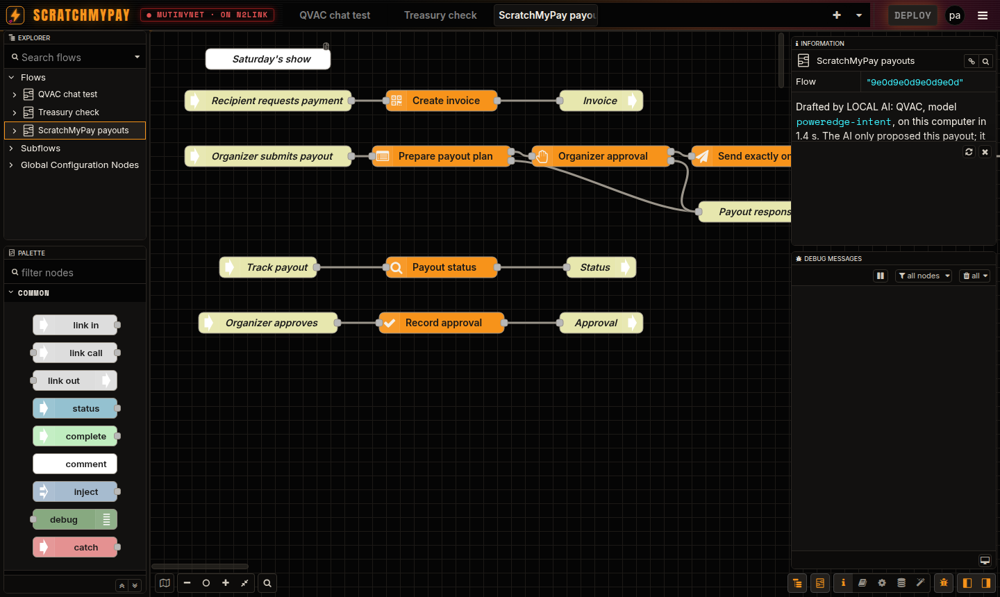
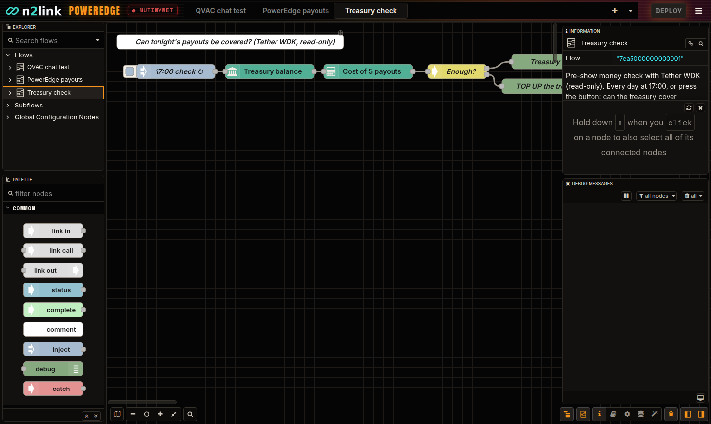

# RGB2link PowerEdge by n2link

**Describe. Validate. Deploy.** A proposed AI-assisted, visual development environment for Bitcoin/RGB applications using the existing [n2link](https://github.com/n2link/n2link) Rust/Node-RED-compatible runtime, locally running QVAC, and verified workflow templates.

> **Status: hackathon build in progress.** Work started 2026-10-15 with the organizers' approval to begin early on a public repository. Target: a complete, live, end-to-end product on Sunday 2026-10-18 13:00 CEST. Nothing below is claimed as working until `docs/IMPLEMENTATION_STATUS.md` records the test or live run that proves it.

## Hackathon submission — "Agentic Dollars on Bitcoin", Turin, Oct 17–18, 2026

**Project:** RGB2link PowerEdge · **Team:** n2link
**Members:** Edwin Kestler ([@EdwinKestler](https://github.com/EdwinKestler)) · [@cms](https://github.com/cms)

**Idea.** Post-show payouts for live events. After a concert, an organizer has to pay the sound engineer, the stage crew and the artist. With PowerEdge they type it in plain words ("Pay the sound engineer 25 tUSDT for Saturday's show"); a local AI (QVAC) turns that into a validated payment workflow, shows a plain-language plan, and the organizer approves it. The payment settles as an RGB asset transfer on Bitcoin (Mutinynet test network), with a receipt both sides can verify. Payout details never leave the organizer's machine.

**Stack.** Rust: [n2link](https://github.com/n2link/n2link) (Node-RED-compatible runtime, editor, Flow Copilot). Python: `rgb-lib` 0.3.0b7 wallet service (FastAPI). Local AI: QVAC (`qvac serve --openai`, structured JSON output). Network: Mutinynet (`signetcustom`). Guided web app served by n2link. WDK: under evaluation (bonus).

**Installed and working before the event (prior work, declared):**
- n2link runtime, editor, Flow Copilot, credential storage, egress policy — `n2link/` at `78d7ba107ed3ade008a9fcc5ab192755c11b8299` (fork of oldrev/edgelinkd, Apache-2.0), imported as one squashed commit.
- RGB Bill (`EdwinKestler/bill` @ `be3d237`): `rgb-lib-python` wallet adapter with plan → confirm → execute-once, proven on Mutinynet; QVAC SDK smoke test. Used as a pinned dependency, not copied.
- Palimnex 2.9.0 (code search / agent memory tooling).
- This repository's design docs, schemas and plan (`docs/`).

**Built for the hackathon** (organizer-approved early start on 2026-10-15): everything not listed above — tracked commit by commit and summarized in `docs/IMPLEMENTATION_STATUS.md`.

### Working now (verified live on Mutinynet, 2026-10-15)
A plain-language request went from local AI to a real RGB transfer:
"Pay the sound engineer 25 tUSDT for Saturday's show" → local QVAC (Qwen3-8B) intent → pinned template `rgb-payment-v1` → validated n2link flow → crew payment request → wallet-prepared plan → human approval → exactly-once send → **txid [`ea4ce78b…43af1`](https://mutinynet.com/tx/ea4ce78b91770ab2b283e1bdf0ab299a7827a859f38d7c0609f1dc4c5ed43af1)** → crew wallet imported the RGB consignment → **crew holds 25.000000 TUSDT (settled)**. Evidence: `artifacts/payouts/2026-10-15-first-live-payout.json`.

| Piece | Where |
|---|---|
| Guided app (Describe → Review → Approve → Track, crew view, EN/ES) | `n2link/crates/web/poweredge-app/`, served at `http://127.0.0.1:1888/poweredge-app` |
| Local AI drafting (QVAC, JSON-schema from the template) | `n2link/crates/web/src/handlers/poweredge.rs`, `services/qvac/` |
| Intent, pinned templates, compiler, validator | `n2link/crates/poweredge/`, `templates/` |
| RGB nodes for n2link (`nodes_rgb`) | `n2link/crates/core/src/runtime/nodes/rgb_nodes/` |
| Wallet-owner service + durable journal | `services/wallet-owner/` |
| Tether WDK treasury service + WDK nodes | `services/wdk-btc/`, `n2link/crates/core/src/runtime/nodes/rgb_nodes/wdk.rs` |

### Install and run (step by step)

Needs: Linux/macOS, Rust ≥ 1.88, Node.js LTS + npm, Python 3.12, git, ~6 GB disk for the local model.

```bash
# 1. Clone WITH submodules (the n2link flow editor is the Node-RED client, pinned at 5.0.7)
git clone --recursive https://github.com/n2link/RGB2linkPowerEdge.git
cd RGB2linkPowerEdge
git clone https://github.com/EdwinKestler/bill.git ../bill   # prior-work wallet adapter (pinned be3d237)
git -C ../bill checkout be3d237

# 2. Build n2link with the RGB nodes; build.rs also builds the flow editor with npm
scripts/setup-editor.sh           # = submodule check + cargo build --features nodes_rgb

# 3. Local AI (QVAC): installs CLI+SDK, downloads Qwen3-8B on first start, serves on 127.0.0.1:11435
(cd services/qvac && npm install) && services/qvac/serve.sh &

# 4. Wallets (Mutinynet test network): create, fund from the faucet, issue the test asset
python3 -m venv services/wallet-owner/.venv && services/wallet-owner/.venv/bin/pip install -r services/wallet-owner/requirements.txt
#    see services/wallet-owner/README.md for provision -> faucet -> create-utxos -> issue_asset
services/wallet-owner/run.sh recipient &  sleep 30;  services/wallet-owner/run.sh payer &

# 5. Tether WDK treasury (read-only; balance, fees, payout cost)
(cd services/wdk-btc && npm install) && node services/wdk-btc/server.mjs &

# 6. n2link with the guided app
scripts/run-n2link.sh

# 7. (once) turn the pay-to-enter door on: creates the break-glass operator password, restarts n2link
scripts/enable-door.sh && scripts/demo-up.sh stop && scripts/demo-up.sh
```

**After the one-time setup above, one command starts (or checks, or stops) everything:**

```bash
scripts/demo-up.sh          # QVAC + crew wallet + WDK -> organizer wallet -> n2link -> QVAC warm-up (~1 min cold)
scripts/demo-up.sh status   # health of each service, organizer funds, WDK treasury check for tonight
scripts/demo-up.sh stop     # stops only the PowerEdge services (matched by port and command)
```

It waits for each service to be really ready (wallets confirm `mutinynet` and mainnet off; QVAC reports the model loaded), skips services already running, refuses to start if a port is held by something else, and keeps logs in `artifacts/run/logs/` (git-ignored).

Open **http://127.0.0.1:1888/poweredge-app** (guided app) and **http://127.0.0.1:1888/** (flow editor, tab "PowerEdge payouts"). Everything listens on 127.0.0.1 only.

### Flow Library: templates the local AI retrieves and adapts
Saved flows live in SQLite (`datadirs/n2link/library/`) in the Copilot's own draft form, so a template is exactly what the model would have drafted. The repo seeds three (`library/seed/`): the pay-me QR page, the pre-show treasury check and a door-revenue report. At draft time the local AI sees the library (name, description, example requests, nodes) and adapts a fitting template instead of drafting from nothing: asked for "every Friday at 16:30 check whether the treasury can cover 8 payouts", it returned the treasury-check template with the new schedule and count. Any editor tab can be saved as a template (`POST /flow-library/from-tab`); payout-path nodes are refused, secret fields are refused, wallet references are stripped and re-bound at deploy, and a template is accepted only if it would deploy on this runtime now. API: `GET/POST /flow-library`, `GET/DELETE /flow-library/{id}`. A library page with "deploy" and "ask the AI to adapt" buttons is planned for Saturday.

### Pay to enter (the business model, live)
There are no accounts and no passwords. An organizer opens **`/poweredge-app/login`**, pays **1,000 test sats** to a fresh address of the Tether WDK treasury and gets a **24-hour pass**; the pass is the same session token a password login would give, so the guided app and the flow editor open unchanged. The fee lands in the same treasury that pays the network fees of every payout: revenue in, fees out, one balance (`scripts/demo-up.sh status` shows "Door revenue"). The demo button pays the door from the organizer wallet (capped at 5,000 test sats, one payment per 30 s, journaled). `scripts/enable-door.sh` turns the door on with a single break-glass user whose random password lives only in `secrets/`; there is no `admin:admin`. Paying proves payment, not identity: binding a pass to the paying key (a signature) is future work.



### Screenshots
| Guided app: describe the payout (local AI) | Flow editor: the managed payout flow (RGB nodes in orange) |
|---|---|
|  |  |

Pre-show treasury check with Tether WDK (green nodes, read-only):


### Look and feel
The flow editor and the guided app share one look taken from our [Satoshi of Live Music](https://satoshi-of-live-music.vercel.app/) page: Bitcoin orange on near-black, with Inter, Space Mono and Anton served from this repo (no font CDN, works offline at a venue). The editor theme is Node-RED's own dark theme recompiled with our palette (`scripts/build-editor-theme.py`), plus a skin in `n2link/assets/theme/`; n2link's build installs it. Fonts: SIL Open Font License (see `n2link/assets/theme/fonts/`).

### Mocked, simulated or hard-coded (honest list)
- **Test money only**: TUSDT is a test asset we issued on Mutinynet (a Bitcoin test network). Nothing runs on mainnet; the wallet service refuses to start for any other network.
- **One template** (`rgb-payment-v1`: pay one person). Multi-recipient payouts are not built yet.
- **Both wallets run on one laptop** for the demo (organizer and crew are separate processes with separate keys and datadirs, talking over loopback). Consignment delivery is a direct local hand-off, not a remote transport.
- **Endpoint ports are fixed** in the template (127.0.0.1:1891–1894); one active payout flow at a time.
- **Approval is a typed name + checkbox** on the organizer's own machine; there is no multi-user login or signature on the approval.
- **The door checks payment, not identity.** Anyone who pays 1,000 test sats gets a 24-hour pass bound to that browser; passes are not bound to a key yet. The "pay from the organizer wallet" button exists so the whole loop runs on one machine; a real organizer would pay from their own wallet.
- **A plan approved before a wallet-service restart must be prepared again** (fail-closed by design).
- **WDK** (Tether Wallet Development Kit): used as a **read-only treasury** on Mutinynet (`@tetherto/wdk-wallet-btc`): balance, live fee rates, cost of tonight's payouts, history. It shows the network cost on the Review/Approve screens and powers the pre-show treasury check (`examples/flows/treasury-check.json`). WDK does not send in this build, and WDK's RGB wallet is not used: it cannot join Mutinynet (`sbc:`) TUSDT payouts (see `docs/WDK_SPIKE.md`).

## Product promise
A developer asks: “Create a testnet RGB payment API with explicit approval, a receipt, and local AI interpretation.” Local QVAC selects a pinned, validated template and fills typed parameters. An independent validator rejects unsupported nodes, unsafe bindings, policy bypasses and unsupported wallet/network combinations. The editor displays the proposed flow. The user approves a versioned deployment. n2link runs the workflow against a privileged, isolated wallet service; immutable audit records and a reconciliation process prove the outcome.

## Non-goals
- Not an Ethereum-style on-chain smart-contract deployment platform: RGB is client-side validated, anchored to Bitcoin single-use seals.
- Not a production self-custody wallet or permissionless signing agent in v0.
- Not Bitcoin Core inside the n2link Wasmi plugin sandbox: `bitcoind`, `electrs`, wallets and QVAC are native processes or containers.
- Not an autonomous authorization system: QVAC cannot sign, transfer funds or deploy arbitrary executables.
- No claims of offline Bitcoin finality.

## Existing source and reuse
- [n2link/n2link](https://github.com/n2link/n2link): Rust runtime, integrated editor, Node-RED-compatible flows, auth, credential storage, egress controls, experimental Wasmi sandbox. It is a fork of oldrev/edgelinkd (Apache-2.0); retain provenance, LICENSE and NOTICE.
- [EdwinKestler/bill](https://github.com/EdwinKestler/bill): proven on-chain RGB `rgb-lib-python` wallet path on Mutinynet and byte-exact BLE artifact transport. Extract adapter patterns; **do not copy wallet state, credentials, seed or device-specific paths**.
- WDK/UTEXO remains optional, separately isolated and behind compatibility tests.

## Sunday deliverable (M0 + M1 + M2, built in parallel)
**M0**: reproducible environment; exact n2link/Bill revisions recorded. **M1**: local QVAC selects an allowlisted template and emits typed parameters; a deterministic compiler and validator generate a valid n2link flow shown in the editor and in the guided app. **M2**: a real isolated RGB wallet pair on Mutinynet: invoice, one human-approved send, recipient import, settlement and receipt. **UX**: a guided app (Describe → Review → Approve → Track) a non-technical user can complete without the flow editor. M1 and M2 are developed in parallel tracks; the only hard rule is that no real send is wired up without the approval gate and journal in place. **M3** (capsules) is post-event.

## Quick start for local Codex
1. Create a working feature branch of n2link; capture base SHA, compiler and platform. Keep existing runtime behavior and tests intact.
2. Copy or mount this specification into your checkout, **without overriding existing `AGENTS.md`**. Read `AGENTS.md`, `docs/DESIGN.md`, `docs/ROADMAP.md` and `prompt.md`.
3. Begin with `prompt.md`; inspect real extension points before editing. First response from Codex must document findings, a minimal plan, risks and chosen module boundaries.
4. Build in small, frequent commits pushed to the public repo; run baseline and targeted tests. Test networks only (Mutinynet/regtest); never mainnet.
5. See `docs/ACCEPTANCE.md` for exit gates and `docs/SECURITY.md` for fail-closed requirements.

## Suggested demo
Prompt → QVAC structured intent → registry selects `rgb-payment-v1` → parameter binding → validator → plain-language review + editor preview → user-approved deployment → invoice → authorized wallet send → recipient import/refresh → receipt. The full chain runs live in the 3-minute judge demo on Mutinynet.

## File map
- `docs/DESIGN.md` — architecture, data/control planes and contracts
- `docs/ROADMAP.md` — dependency-aware milestone plan
- `docs/SECURITY.md` — threats and explicit trust boundaries
- `docs/ACCEPTANCE.md` — automated and manual test gates
- `docs/DECISIONS.md` — architecture decisions / unresolved questions
- `prompt.md` — first Codex execution prompt
- `AGENTS.md` — local agent instructions
- `SKILLS.md` — skill catalog and routing
- `.agents/skills/*/SKILL.md` — modular agent skills
- `schemas/workflow-intent.schema.json` — proposed constrained QVAC output schema
- `templates/rgb-payment-v1.template.json` — **illustrative template manifest, not deployable Node-RED flow**

## Hackathon provenance (declared prior work)
Prior work, not authored for this hackathon: n2link runtime/editor/Flow Copilot at `78d7ba107ed3ade008a9fcc5ab192755c11b8299` (fork of oldrev/edgelinkd, Apache-2.0); RGB Bill wallet adapter at `be3d237`; Palimnex 2.9.0 tooling. Everything else is new work since 2026-10-15 (organizer-approved early start). The Friday 23:00 snapshot and this README list what existed at that point; commits after it are the in-event delta. Keep evidence (commit SHAs, tests, txids, QVAC runtime logs) and list anything mocked, simulated or hard-coded.

## License

This project is source-available under the **PolyForm Noncommercial License 1.0.0**.

Original RGB2link components, including RGB workflow nodes, wallet integrations, MVM orchestration, and PowerEdge extensions, are available for permitted noncommercial uses, including qualifying research, education, experimentation, modification, and redistribution.

Commercial use of these components requires separate written authorization from the respective copyright holders. This includes commercial production deployments, paid hosting, resale, and commercial integrations where the intended use is not permitted under the PolyForm Noncommercial License.

This project incorporates third-party and upstream components distributed under their own licenses, including the Apache License 2.0. Those components retain their original licensing terms and associated rights.

See `LICENSE`, `LICENSES.md`, and `NOTICE` for applicable license terms and attribution requirements.

For commercial licensing inquiries, contact the project maintainers.


## Source reuse and Palimnex knowledge base

Read [`reusecode.md`](reusecode.md) before editing third-party or existing project code. Read [`referencerepos.md`](referencerepos.md) for verified repository URLs, safe clone commands, pinned checkout metadata, and index exclusions. Both are mandatory references for local Codex.
