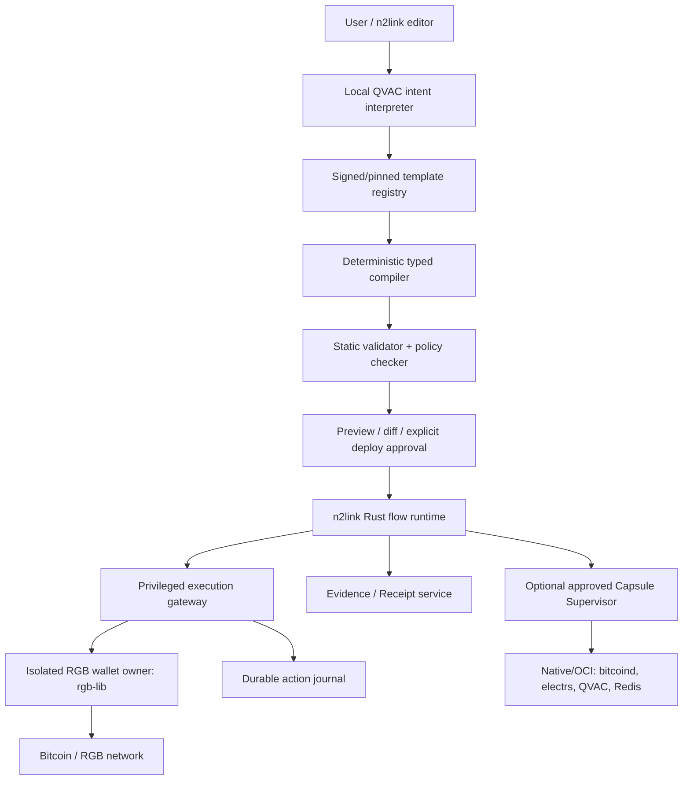
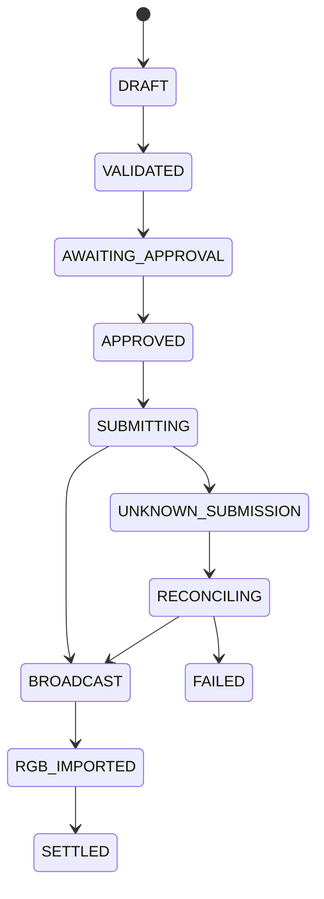

# DESIGN — RGB2link PowerEdge

Status: **proposed v0.1 architecture** · Date: 2026-10-13

## 1. Problem and bounded solution
RGB application setup requires several independent components: Bitcoin chain access, client-side validated RGB wallets, consignments and transport, signing, local AI and deployment lifecycle. PowerEdge offers a visual orchestration surface over **existing protocol implementations**; it does not redefine RGB consensus, make arbitrary on-chain computation possible, or treat a general flow editor as a financial signer.

## 2. Design objectives
1. Compose supported RGB dApp backends with n2link/Node-RED-compatible templates.
2. Local QVAC proposes **template ID + typed inputs**, never privileged instructions or arbitrary flow JSON.
3. Deterministic compiler creates pinned n2link graphs; validator checks nodes, edges, networks, security controls, and parameters.
4. Separate *control plane* (flow proposal/approval/deploy), *data plane* (flow events), and *financial authority plane* (wallet/signer operations).
5. Reuse RGB Bill's proven rgb-lib adapter workflow; avoid regression to accepted payment path.
6. Later provision approved native/OCI **Service Capsules** (regtest, electrs, Redis, QVAC), with independent lifecycle and readiness.
7. Allow future WDK and Lightning backends behind explicit capability discovery and compatibility tests.

## 3. System architecture

**Control-plane invariant:** AI output and untrusted flow messages cannot directly call a signer. An approval is cryptographically or durably bound to `{flow_revision, environment, wallet_id, asset_id, plan_digest, amount_limit, recipient_set, expiry, actor}`. A change invalidates approval.

## 4. Reuse versus new implementation
| Layer | Existing base | New work | Gate |
|---|---|---|---|
| Rust runtime & editor | n2link | Plugin/native RGB nodes, template previews | Existing regression suite |
| QVAC | Local runtime/SDK (deployment-dependent) | Structured intent adapter | Real local inference, no cloud fallback |
| RGB wallet | Bill rgb-lib Python path | Wallet owner service + Rust client | Confirmed isolated-wallet transfer |
| WDK | UTEXO optional | Separate Node.js adapter | Same-network, asset/schema, OOB API tests |
| Capsule lifecycle | n2link process/runtime foundations | Privileged supervisor | Native process first; OCI later |
| Protocol schema compiler | None | Research-only, future | Excluded from MVP |

## 5. Suggested component boundaries
- `poweredge-intent`: strict JSON schema for local QVAC template selection and slot filling; untrusted output.
- `poweredge-template-registry`: signed or digest-pinned immutable manifests and approved node versions.
- `poweredge-compiler`: deterministic graph generation, stable IDs, explicit types, no dynamic scripts unless approved/pinned.
- `poweredge-validator`: graph structure, control-flow, data-flow, capabilities, network and financial policy; reject unknown nodes.
- `poweredge-wallet-gateway`: narrow typed RPC to **single-owner** wallet service; never expose seeds, signing keys, raw general-purpose RPC or unrestricted shell.
- `poweredge-journal`: durable state machine, idempotency, reconciliation, evidence hash and receipt tracking.
- `poweredge-capsules` (post-M1): allowlisted native/OCI service catalog, lifecycle, health, resource and egress limits.

## 6. Initial contract: WorkflowIntent v1
Model output contains `template_id`, `template_version`, `environment`, `parameters` and `rationale`. Template ID/version must match registry. The compiler—not the AI—sets node types, wires, privilege scopes, port bindings and signer actions. Any output failing JSON schema validation is rejected, with no opportunistic repair by financial nodes. See `schemas/workflow-intent.schema.json`.

## 7. Template manifest and compiler
A template manifest specifies immutable ID, version, digest, typed input slots, network requirements, capabilities, approved n2link nodes, forbidden edges, mandatory authorization nodes and integration-test IDs. Compilation stages:
1. Parse intent (strict schema, bounded size).
2. Resolve pinned template and artifact hashes.
3. Validate supported networks and wallet backend capabilities.
4. Bind typed parameters and normalize asset base units (integers only).
5. Produce deterministic canonical intermediate representation.
6. Static-check graph safety and secret/data provenance.
7. Compile to actual n2link Node-RED-compatible flow nodes using **verified current repository APIs**.
8. Render preview and before/after diff; deploy only with explicit approval.

## 8. Wallet interface (proposed RPC, not existing API)
`capabilities`, `health`, `balance`, `create_invoice`, `prepare_send`, `approve_plan`, `execute_once`, `export_consignment`, `import_consignment`, `refresh`, `get_transfer`.

Key rules:
- One process owns each wallet datadir. Never simultaneously mount in Bill and PowerEdge.
- A `prepare_send` result is immutable and records fee, recipients, asset contract, chain ID and transaction intent hash.
- `execute_once(plan_id, approval_id, idempotency_key)` must persist intent and approval *before* possible broadcast. Unknown outcome transitions to `UNKNOWN_SUBMISSION`, never automatic resend. Reconcile against wallet and network.
- An exact RGB state transition and Bitcoin confirmation are distinct states; BLE transfer ACK is not settlement.
- OOB export/import are **required capabilities** for the RGB Bill template, not assumed in WDK.

State machine:

`FAILED` can mean no valid submission evidence, not proof that no transaction was broadcast. Reattempts require a new independently verified plan or a state-specific recovery operation; not blind retry.

## 9. QVAC execution
- The actual local SDK/runtime/model must be detected, pinned, and smoke-tested. Do not silently substitute remote APIs or fabricated inference.
- Schema-constrained output with a limit on runtime, input bytes and output bytes.
- QVAC must explain selected template and parameters; rationale is **non-authoritative**.
- No seeds, credentials, wallet datadirs or private consignments enter model prompts by default.
- Plan previews should be generated deterministically from real wallet state, not AI guesses.

## 10. Service Capsules (M3+)
A Service Capsule is a declarative **privileged supervisor resource**, not a Wasmi guest. Backends: supervised native process first; OCI next; Firecracker/KVM future. Support Redis, QVAC worker, bitcoind in regtest, electrs and wallet owner service. Manifest fields: trusted image/binary digest, args allowlist, network, file mounts, CPU/memory/disk, ports, readiness, restart policy, identity. Default-deny external binds, mounts and network egress. Do not launch arbitrary user-provided executables from a flow.

Startup order should use *readiness*, not just process start; Bitcoin RPC, indexer sync and wallet consistency are separate health conditions. Snapshots of regtest chain and wallet state must be consistent and isolated from public networks. Lightning live channel-state snapshots are explicitly out of scope.

## 11. Network and asset compatibility
Treat Bitcoin network identity, RGB invoice/network tag, RGB contract/schema, and transport separately. Mutinynet `signetcustom`/`sbc:` vs Signet `sb:` and UTEXO WDK support must be validated rather than coerced by string substitution. No mainnet by default. Cannot assume faucet USDT schema or WDK OOB support without inspection.

## 12. Built-in application templates
- `bitcoin-regtest-v1`: provision isolated testing infrastructure; no financial authority.
- `rgb-payment-v1`: invoice → plan → explicit approval → send/import → reconcile → receipt.
- `rgb-proofpay-v1`: verify wallet receipt and transaction evidence.
- `rgb-splitpay-v1`: multi-recipient planning and settlement, later gate.
- `mergepay-v1`: GitHub merged PR evidence → QVAC ranking → human approval → RGB payouts; Bitcoin timelock escrow is separate, later gate.

## 13. Security and deployment
See `docs/SECURITY.md`. Reject graph edges bypassing approvals; bind authorizations to exact flow revision and financial plan. Keep evidence auditable. Model-generated flows start as draft previews, never auto-deploy or auto-spend. Verify `n2link` versions and actual node APIs at implementation time.

## 14. Scope for hackathon
Sunday target: M1 + a real on-chain Mutinynet RGB flow (M2) + a guided app a non-technical user can complete, all live. An infra-only capsule demonstration is insufficient for meaningful RGB/QVAC integration. Show full provenance of pre-existing n2link/Bill work and dated new commits (early start since 2026-10-15 approved by organizers). Judging weights: RGB 25%, QVAC 20%, Execution 20%, UX 15%, Innovation 10%, Marketability 10%, WDK bonus +1.
